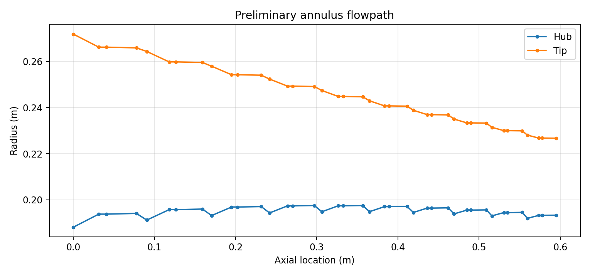

# Project 2 — Multistage Axial Compressor Mean-Line Model

A manually configured Python model for studying multistage axial-compressor
mean-line thermodynamics, Euler work, velocity triangles, stage loading, and
annulus geometry. It solves one selected design at a time and records
stage-by-stage outputs and transparent screening checks.

**Project status:** Complete for the intended learning scope. The work
emphasized compressor thermodynamics and mean-line methods; aerodynamic
prediction and rigorous physical validation are deferred to the future Project 2.1.

**Development note:** AI tools assisted with code implementation and
refinement. The project objectives, selected assumptions, and engineering
interpretation are documented here; the model's limits are stated explicitly.

**License:** MIT for this project's code; see [`LICENSE`](LICENSE). The NASA/GE
report used for the benchmark is a separate source document and is not covered
by this project license. The report PDF is not redistributed here; the NASA
NTRS record is linked in the [benchmark notes](validation/README.md).

## Project highlights

- Solves stage loading to meet a user-selected overall pressure ratio, then
  reports stage work, pressure rise, velocity triangles, annulus geometry, and
  approximate hardware-mass breakdown.
- Makes design choices explicit: stage count, speed, flow coefficient, radius
  profile, loading profile, and assumed stage efficiency.
- Implements a **lossless rotor** assumption and assigns modeled stage entropy
  generation to the stator, removing the rotor/stator entropy-split input.
- Preserves failed screening checks in the output rather than silently
  redesigning an infeasible case.
- Includes equation-level verification and a scoped NASA/GE LSRC comparison;
  neither demonstrates broad aerodynamic accuracy.

## Demonstration case

The documented 10-stage example reaches **PR 5.0** at 16 kg/s and 9,000 rpm,
with **215.23 kJ/kg** modeled specific work. It passes all 326 implemented
screening checks. Geometry and mass figures are outputs of simplified
illustrative assumptions, not physical hardware predictions.



The NASA/GE LSRC first-pass comparison found the model's third-stage Euler work
within **2.35%** of work calculated from a measured midspan velocity triangle
for that selected point. The comparison retains substantial assumption
mismatches and does not independently validate the full compressor model.
See the [benchmark setup and interpretation](validation/README.md).

## Resume / portfolio summary

**Multistage Axial Compressor Mean-Line Model** — Built a configurable Python
model to study stagewise Euler work, velocity triangles, pressure rise, and
annulus geometry in a multistage axial compressor. Implemented a lossless-rotor
assumption and transparent per-stage screening; compared a four-stage setup
with NASA/GE LSRC data, with third-stage Euler work within 2.35% for one
selected midspan case. Documented that the comparison is limited and does not
establish broad aerodynamic validation.

For interviews, distinguish the equation-level checks and this selected-point
consistency comparison from experimental validation. The [validation
record](docs/validation.md) and [project limits](#6-interpretation-and-closeout)
give the full context.

---

**Status: Complete for the original learning scope.** P2 was built as a compact,
manually configured study of compressor thermodynamics, Euler work, velocity
triangles, design parameters, and multistage calculations. It is not intended
to predict aerodynamic efficiency or serve as a validated compressor design
tool. Further aerodynamic model development and more rigorous validation are
deferred to future projects.

**Purpose:** Solve and investigate **one user-specified design at a time**. This rebuild retains the original preliminary mean-line stage and hardware-mass calculations, removes differential evolution, the mass-minimization objective, and automatic mass-flow sweeps, and exposes separate loading and radius distributions. The model **does not** independently predict aerodynamic efficiency or predict a physical compressor with validated accuracy.

## 1. Install and run

Use Python 3.10+ in this directory:

```bash
python -m pip install -r requirements.txt
python compressor.py --output results
python -m unittest discover -s tests -v
```

The default design targets **14:1 pressure ratio** with 16 stages, 16 kg/s, 10,500 rpm, and a linearly decreasing mean radius. **That exact default design currently FAILS some illustrative geometry checks, as the program reports.** A numerically solved pressure-ratio target does not imply a feasible compressor. This is intentional: the solver does not silently change your chosen inputs.

To start with a configuration that passes the *implemented illustrative* screening checks (not external validation):

```bash
python compressor.py --pressure-ratio 5 --stage-count 10 --rpm 9000 --radius-in 0.23 --radius-out 0.21 --output example_pr5
```

To specify *your own* design, edit the CLI arguments or use the Python interface below. **There is no optimizer.** The only iterative numerical operation is a *scalar* root solve to scale the user-selected loading profile to the pressure-ratio target.

## 2. Python interface: direct control of each study

```python
from dataclasses import replace
from compressor import CompressorDesign, Assumptions, solve_compressor, evaluate_design, save_results
from pathlib import Path

design = CompressorDesign(
    inlet_t0=300.0, inlet_p0=101325.0, mass_flow=16.0,
    pressure_ratio_target=14.0, stage_count=16,
    rpm=10500.0, phi=0.55,
    radius_in=0.25, radius_out=0.21,
    radius_profile="linear", radius_exponent=1.0,
    loading_profile="constant", loading_shape=0.0,
)

result = solve_compressor(design)
report = evaluate_design(result)
save_results(result, report, Path("my_first_design"))

# USER-DIRECTED study: one variable changes at a time; no hidden redesign.
second_design = replace(design, rpm=11000.0)
second_result = solve_compressor(second_design)
print(second_result["stages"][0]["psi"])
```

For custom screening limits or rough hardware assumptions, pass `Assumptions(...)` to `solve_compressor(design, assumptions)`. By default `evaluate_design(result)` reads the exact assumptions stored in the result. If you pass an explicit `Assumptions` object to `evaluate_design`, it must match the solver assumptions or the evaluator raises a `ModelError`.

## 3. All user-adjustable input choices

- Operating conditions: `inlet_t0` (K), `inlet_p0` (Pa), `mass_flow` (kg/s), `pressure_ratio_target` (stagnation P-out/P-in).
- Configuration: `stage_count` (positive integer), `rpm`, `phi` (common stage flow coefficient Vx/U at the mean radius).
- Radius: `radius_in`, `radius_out` (first/last stage *arithmetic* mean annulus radii, m), `radius_profile` = `"constant"`, `"linear"`, or `"power"`. For `"power"`, `radius_exponent` is positive; p=1 reproduces linear, 0<p<1 decreases earlier when radius_out<radius_in, p>1 decreases later. `"constant"` requires equal front and rear radii.
- Loading: `loading_profile` = `"constant"`, `"linear"`, or `"exponential"` plus `loading_shape`. `"constant"` requires shape=0. For `"linear"`, shape=a with |a|<1, and weight `w(x)=1+a*(1-2*x)`; a>0 front-loaded. For `"exponential"`, shape=k and weight `w(x)=exp(k*(x-0.5))`; k<0 front-loaded. Shapes are normalized to mean weight 1. Their **magnitude** is not an independent input: the scalar root solve sets `psi_i = loading_scale * weight_i` to achieve the target pressure ratio. When radius varies, constant psi **does not** mean constant stage work, since `delta_h0_i = psi_i * U_i**2`.

Normalized position `x_i=(i-1)/(n-1)` runs from 0 to 1; one-stage verification uses x=0.5 and equal end radii. The baseline gives **zero inlet swirl for every rotor**, the stator removes rotor-exit swirl, and the flow coefficient is constant *by stage*, so Vx may change between stages with radius. This is NOT an inlet guide vane, interstage matching, leakage, or radial-equilibrium model.

CLI example with nonlinear loading and a nonlinear decreasing mean radius:

```bash
python compressor.py --pressure-ratio 8 --mass-flow 16 --stage-count 12 --rpm 10500 --phi 0.55 --radius-in 0.25 --radius-out 0.21 --radius-profile power --radius-exponent 1.5 --loading-profile exponential --loading-shape -0.6 --output nonlinear_case
```

A nonlinear option is just a *specified mathematical shape*. It is not asserted to be physically superior or to represent any manufacturer's preferred profile.

## 4. Physical calculation and limits

For each stage, the root-solved loading gives Euler work `delta_h0=psi*U**2`, `T0,out=T0,in+delta_h0/cp`, and, **assuming 85% constant stage isentropic efficiency**, `P0,out/P0,in=(1+eta*delta_h0/(cp*T0,in))**(gamma/(gamma-1))`. The rotor is assumed lossless: its stagnation pressure rise is isentropic for the modeled temperature rise, and all modeled stage entropy generation is assigned to the stator. This removes an adjustable rotor/stator loss-split parameter. The stator adds no shaft work, so stagnation temperature is the same at rotor and stator exits. The rotor outlet has `Vtheta2=delta_h0/U`; both rotor inlet and stator exit have `Vtheta=0`.

At the rotor inlet, rotor exit, and stator exit, an ideal-gas total-to-static conversion uses absolute speed. Continuity `mdot=rho*A*Vx` gives the annulus area. Mean radius is defined here as `(rh+rt)/2`, so `height=A/(2*pi*rm)` and `rh=rm-height/2`, `rt=rm+height/2` exactly describe the modeled annulus. **Each stage uses one mean radius for its rotor and stator.** The model retains the original simplified blade aspect-ratio, solidity, shape-factor, axial-spacing, component-volume and thin-shell-mass assumptions. The inter-row and interstage gaps are idealized as **lossless**; no validated interstage duct model exists. The tip Mach number is a crude mean-line-based estimate; it is not a radial flow calculation.

The evaluator reports separate pass/fail and numerical margin for *each* applied loading, reaction, Mach, diffusion, hub/tip radius, blade-height, wall-slope, rpm, mean-radius and flow-coefficient screening check. It does **not** compute a deceptive single feasibility score or automatically adjust a failing design. If the annulus or static thermodynamic state is mathematically unrepresentable, it raises a `ModelError` rather than fabricating dimensions.

## 5. What each run returns

The console displays inputs, achieved PR, discharge T0, specific work, estimated shaft power, axial length, maximum diameter, rough mass, pass/fail and failed constraints, and a per-stage summary. Its output directory contains:

- `design_results.json` — complete user inputs, assumptions, every stage and station, mass breakdown, and every screening check.
- `stage_results.csv` — numeric stage-level work, loading, geometry position, stage PR and diffusion/reaction indicators.
- `station_results.csv` — per-station stagnation/static states, velocities, angles, annulus area, hub/tip radii and Mach estimates.
- `constraints.csv` — every threshold, measured value, margin, location, and pass/fail result.
- `mass_breakdown.csv` — separately accounted approximate modeled components.
- `flowpath.png`, `loading_profile.png` — visualization of the single input design (skip with `--no-plots`).

## 6. Interpretation and closeout

**The eight equation-level checks in `tests/` verify consistency of implemented equations, not the physical validity of this compressor design.** Constant `cp=1005 J/(kg K)` and `gamma=1.4` are substantial approximations, especially for the high discharge temperatures of high-PR cases. Stage efficiency is **specified**, not calculated from blade shapes, loading, clearance, diffusion or losses. The diffusion factor is an indicative blade-row measure rather than full profile-loss/operating-range prediction. No variable gas properties, choking, blockage, incidence/deviation, surge/stall margin, radial equilibrium, detailed blade profile/CFD, turbine coupling, shaft stress, rotor dynamics, casing strength, real material selection or manufacturing clearance is assessed.

The listed material densities, structural dimensions and limit values carry over as **illustrative inputs from the original exploratory model**, not verified engineering design standards. The computed mass excludes some real hardware and does not demonstrate that represented hardware is structurally adequate. Passing any screening condition does **not** certify aerodynamic feasibility, efficiency, or manufacturability. The resulting tool is appropriate for learning, controlled parameter studies, conservation checks, and progressively improving the assumptions—not for a final compressor design.

**Current closeout example:** the 10-stage, 16 kg/s, 9,000 rpm, PR 5.0 case in `examples/results/pr5_10stage_16kg_s/` reaches PR 5.000000 and passes all 326 implemented screening checks. The untouched default (16 stages, PR 14.0) reaches its target but fails 35 of 518 checks, chiefly minimum blade-height screens. These are checks of the selected model and thresholds, not independent aerodynamic validation. The equation-level verification and run details are in `docs/validation.md`.

**P2 closeout:** the intended learning scope is complete. The NASA/GE LSRC first-pass comparison in `validation/` exercised the thermodynamic work relation and compared P2's third-stage Euler work with a measured NASA midspan velocity triangle. That comparison is a consistency check under prescribed efficiency and simplified flow assumptions; it is not independent validation of compressor efficiency, broad aerodynamic accuracy, or design feasibility. The benchmark exposed the limits of P2's intentionally simplified aerodynamic representation. Further aerodynamic modeling and more rigorous validation belong to Project 2.1.

Project 2.1 is planned to incorporate aerodynamic logic also implemented in Project 3, creating a more complete P2 model that is more appropriate for deeper validation. The detailed P2.5 scope will be specified when that phase begins.

## 7. Editable study starter

Open `my_studies.py` and edit a single input (or uncomment one `replace(...)` line) to run your own **one-design-at-a-time** investigation. It does not call an optimizer or automatically loop over mass flows. The program outputs its stage and station properties so that you can write *your own* comparison scripts later.

The earlier optimizer-based seeded study is retained as `docs/historical_optimizer_study.md`. It describes a previous model version and is not reproduced by the current one-design-at-a-time solver.
